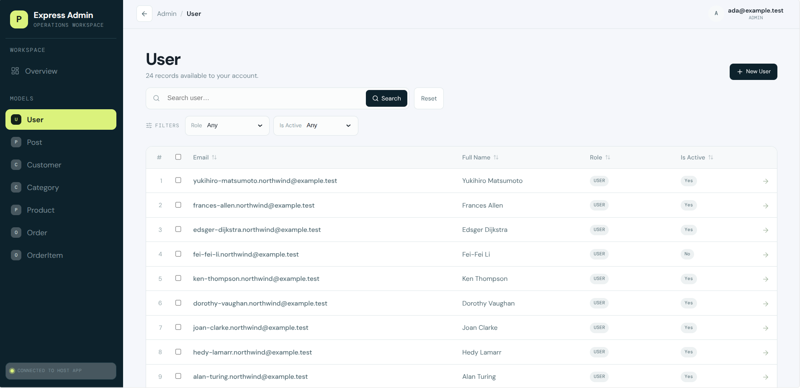

<div align="center">

# PanelJS

**A Django-style admin panel for Node.js.**
Add a working admin UI to your existing Express app, built from your Prisma, TypeORM, or MikroORM models.

[](https://www.npmjs.com/package/paneljs)
[](https://www.npmjs.com/package/paneljs)
[](./LICENSE)

[Website](https://paneljs.com) · [Docs](https://paneljs.com/docs/) · [Installation](https://paneljs.com/docs/guide/installation/) · [Examples](./apps)

<picture>
  <source media="(prefers-color-scheme: dark)" srcset="./apps/web/public/images/product-dark-users.png">
  
</picture>

</div>

## Why PanelJS

You already described your data once, in `schema.prisma` or your entity classes. You shouldn't have to describe it again to get an admin panel.

PanelJS reads the models from your ORM and serves a React admin UI at `/admin`, plus a guarded JSON API behind it. `admin.register("User")` with no config gives you a list, search, filters, and a create/edit form.

- **Schema-driven.** Your ORM is the source of truth. There's no second admin schema to keep in sync.
- **Three ORMs, one API.** Prisma, TypeORM, and MikroORM. After `mount`, your admin code is the same whichever one you use.
- **Mounts on your app.** It isn't a separate service or a project generator. No React build step in your app; the UI ships pre-built.
- **Auth your way.** Use the built-in admin-only login and sessions, or map your existing session, JWT, or API key onto an admin user.
- **Tenant scoping built in.** A `scope()` function is applied to every list, read, update, delete, relation picker, and action, so an admin can't reach another tenant's rows by guessing an ID.
- **Safe defaults.** Password-like fields stay hidden, unknown write keys are rejected, and the schema endpoint sits behind the same auth as CRUD.
- **Room to grow.** Role permissions, bulk actions, lifecycle hooks, and an audit event stream you can write wherever you like.

## Quick start

```bash
npx paneljs@latest init
```

`init` asks for your ORM and package manager, then installs `paneljs`, `@paneljs/express`, and the matching adapter. It doesn't touch your source files.

Then mount it:

```ts
import express from "express";
import { createAdmin } from "paneljs";
import { prismaAdapter } from "@paneljs/prisma";
import { mount } from "@paneljs/express";

const app = express();

const admin = createAdmin({
  adapter: prismaAdapter({ prisma }),
  auth: { mode: "built-in", identifier: "email" },
});

admin
  .register("User")
  .register("Post", { listDisplay: ["title", "author", "published"] });

await mount(app, admin);
app.listen(3000); // admin at http://localhost:3000/admin
```

Built-in auth needs two admin tables. The [authentication guide](https://paneljs.com/docs/guide/auth) shows how to create them for each ORM, or how to use your own auth with `getCurrentUser` instead.

### Using TypeORM or MikroORM

Swap the adapter. Everything else stays the same.

```ts
import { typeormAdapter } from "@paneljs/typeorm";
const adapter = typeormAdapter({ dataSource }); // after dataSource.initialize()
```

```ts
import { mikroormAdapter } from "@paneljs/mikroorm";
const adapter = mikroormAdapter({ orm }); // after MikroORM.init()
```

## Support

| Layer          | Supported today            | Planned         |
| -------------- | -------------------------- | --------------- |
| ORM            | Prisma, TypeORM, MikroORM  | Drizzle         |
| HTTP framework | Express                    | Fastify, NestJS |
| Node.js        | `^20.19`, `^22.12`, `>=24` |                 |

Writes cover scalar fields and `belongsTo` foreign keys. Many-to-many editors, inline child tables, and file uploads aren't built yet. The full list is in [What is not included](https://paneljs.com/docs/limits/not-included).

## Documentation

- [What PanelJS is (and isn't)](https://paneljs.com/docs/guide/what-this-is)
- [Installation](https://paneljs.com/docs/guide/installation/)
- [Lists, search, and filters](https://paneljs.com/docs/guide/lists)
- [Permissions](https://paneljs.com/docs/guide/permissions) and [tenant scope](https://paneljs.com/docs/guide/scope)
- [Bulk actions](https://paneljs.com/docs/guide/actions), [hooks](https://paneljs.com/docs/guide/hooks), and [audit log](https://paneljs.com/docs/guide/audit)

## Packages

| Package                                    | Role                                       |
| ------------------------------------------ | ------------------------------------------ |
| [`paneljs`](./packages/paneljs)            | Core: registry, schema JSON, admin UI, CLI |
| [`@paneljs/express`](./packages/express)   | `mount(app, admin)`                        |
| [`@paneljs/prisma`](./packages/prisma)     | `prismaAdapter()`, DMMF introspection      |
| [`@paneljs/typeorm`](./packages/typeorm)   | `typeormAdapter()`                         |
| [`@paneljs/mikroorm`](./packages/mikroorm) | `mikroormAdapter()`                        |

## Contributing

Issues and pull requests are welcome. If you hit a bug or a missing feature, [open an issue](https://github.com/divinesta/paneljs/issues) with your ORM and database.

This is a pnpm + Turborepo monorepo:

```bash
pnpm install
pnpm example:db:up   # Postgres via Docker
pnpm example         # Prisma + Express example app
pnpm test            # unit tests
pnpm test:all        # unit, integration, and e2e
```

The example apps (`apps/example`, `apps/example-typeorm`, `apps/example-mikroorm`) run the same multi-tenant scenario on each ORM. `apps/docs` is the VitePress documentation and `apps/web` is the marketing site. Testing requirements and package ownership are in the [behavior matrix](./docs/testing/behavior-matrix.md).

## License

[MIT](./LICENSE)
